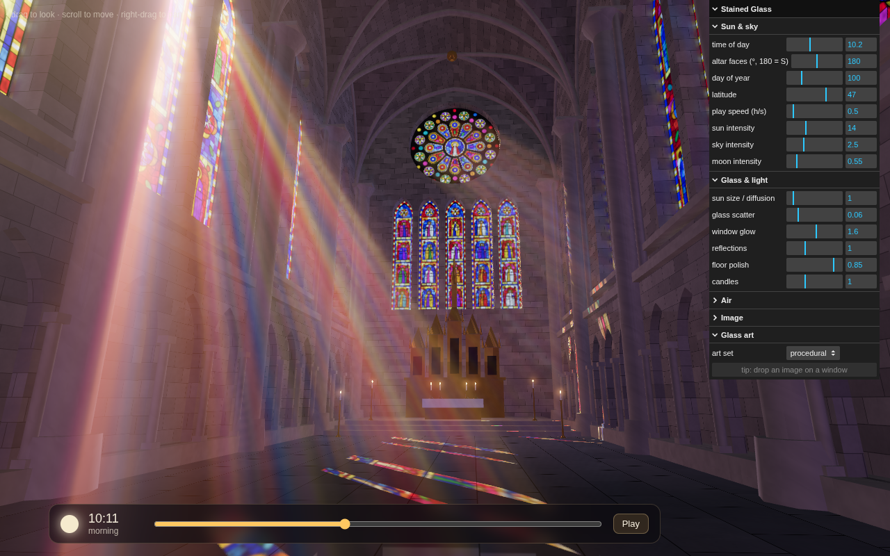

# stained-glass

Stained glass realism in three.js: a procedural gothic hall where sunlight (or moonlight) is filtered by the windows, projected onto the stone, and scattered in the air as coloured shafts. Drag the time slider to move the sun from east to west.



## Run

```bash
./run.sh         # installs on first run, serves and opens http://localhost:5173
# or manually:
npm install
npm run dev
npm run build    # static site in dist/
```

URL parameters: `t` (hour), `day` (day of year), `lat`, `heading` (compass bearing the altar faces), `art` (art set name or `procedural`), `view` (`nave`, `floor`, `side`, `entrance`, `rose`, `low`), `play=1`, `ui=0`, `ppm` (glass texels per metre, default 128; lower it on weak GPUs), `dpr`.

`npm run shot -- <outDir> "t=12.5&view=floor" ...` takes headless screenshots (needs the dev server and Chrome). `node tools/motion.mjs` and `node tools/flicker.mjs` drive the camera and fail-check every frame for black or NaN pixels.

## Sun path and orientation

The altar end faces **south** by default (`altar faces` slider, `heading` parameter). The morning sun then comes through the left wall, the midday sun straight through the altar windows down the nave, and the afternoon sun through the right wall, so every window wall gets its turn. Set it to 90 for a traditional east-facing church.

## Your own glass

Any window can show a picture instead of the generated design. Only the colours matter: bright, saturated images with dark outlines work best, because the image *is* the light filter.

- **Drag and drop** an image file onto a window to replace it for the session.
- **Art sets**: put files in `public/glass/` and list them in `public/glass/manifest.json`, then pick the set in the panel.

```json
{
  "default": "neko",
  "sets": {
    "neko": {
      "slots": {
        "side": ["neko/side-1.webp", "neko/side-2.webp"],
        "altar-lancets": "neko/altar-lancets.webp",
        "altar-rose": "neko/altar-rose.webp",
        "entrance-lancets": "neko/entrance-lancets.webp",
        "entrance-rose": "neko/entrance-rose.webp"
      }
    }
  }
}
```

| Slot | Covers | Shape (w × h) |
| --- | --- | --- |
| `right-1` … `right-6`, `left-1` … `left-6` | one side bay: two lancets and the oculus above | 5.3 × 13.2 m, about 2:5 |
| `side` | list of images cycled over all twelve side bays | same |
| `altar-lancets` | the row of five lancets | 9.8 × 9.1 m, about 1:1 |
| `altar-rose`, `entrance-rose` | rose window | 1:1 |
| `entrance-lancets` | the row of four lancets | 7.5 × 5.5 m, about 4:3 |

Images are scaled to cover the slot and cut by the stone, so one picture spans a whole group of openings.

## How the light works

Everything derives from `src/layout.js`, which lists the walls and their window openings. The same data cuts the holes in the wall geometry, paints the glass, and tells the shader where the glass is, so the projection always lines up.

**Glass as a colour filter.** Each wall has one texture whose RGB is the glass *transmittance*: the fraction of red, green and blue light that passes. Lead cames, iron bars and stone tracery are black. Light that reaches a point `P` is

```
E(P) = E_sun · shadow(P) · Π T_wall( hit(P, L) )
```

**Exact projection.** `hit` is a ray-plane intersection from `P` toward the sun `L`, evaluated per pixel (`paneHit` in `src/shaders/glassLight.glsl`). There is no projector texture or coloured shadow map, so the image stays sharp regardless of shadow resolution.

**Physically sized blur.** The sun is a disc 0.53° across, so each point of glass lights a cone. The image on the floor is the glass convolved with a disc of diameter `t · 0.0093` where `t` is the distance from the glass: crisp near the window, soft 20 m away. The shader gets this from the mip chain plus a 5-tap kernel. The "sun size / diffusion" slider scales it.

**Opaque occlusion.** Walls, piers, vault and furniture go into an ordinary depth map rendered from the sun (4096², fitted to the building). Glass is excluded from it.

**God rays.** A half-resolution ray-march from the camera to the first surface evaluates the same `shadow · T` at each step (single scattering, Henyey-Greenstein phase), so the shafts carry the colours of the glass they came through. A depth-aware filter removes the jitter noise.

**The windows themselves.** Seen from inside, glass shows `T · (sky + scattered sun)`, brighter toward the sun. The same function drives the glossy floor reflections (reflection ray against the wall planes, blur by roughness) and a soft coloured fill light from each wall, with no extra render passes.

**Sun and moon.** `src/sun.js` computes solar position from time, day of year and latitude; `main.js` rotates it into the building's frame. Air mass reddens the beam near the horizon. A full moon sits opposite the sun and takes over at night, with the exposure opening up.

## Files

| File | Role |
| --- | --- |
| `src/layout.js` | Dimensions, walls, window openings, pane rectangles |
| `src/glassArt.js` | Canvas 2D stained glass (figures, medallions, rose windows) |
| `src/cathedral.js` | Geometry: walls, rib vault, arcade, altar |
| `src/shaders/glassLight.glsl` | The light-transport core shared by all shaders |
| `src/shaders/surface.frag` | Stone, floor, wood and gilding |
| `src/shaders/volumetric.frag`, `composite.frag` | God rays |
| `src/pipeline.js` | Sun depth map, HDR scene, rays, bloom, tone map |
| `src/sun.js` | Sun and moon position, sky colour |

## Phase 2: Unity URP 6

The model was chosen to port directly:

- `glassLight.glsl` is plain functions over a few uniforms; it translates to an HLSL include nearly line for line. Pane data (plane, origin, U, V, texture) becomes global shader properties set by a `StainedGlassPane` component.
- URP's main-light shadow map replaces the custom sun depth map. Glass renderers have shadow casting off.
- Surfaces call `glassTransmit` to tint the main light: a custom lit shader, or a Shader Graph custom function node.
- God rays become a full-screen pass in a `ScriptableRendererFeature` reading the camera depth texture.
- Pane textures can be painted art instead of the procedural canvases; only RGB transmittance matters.
